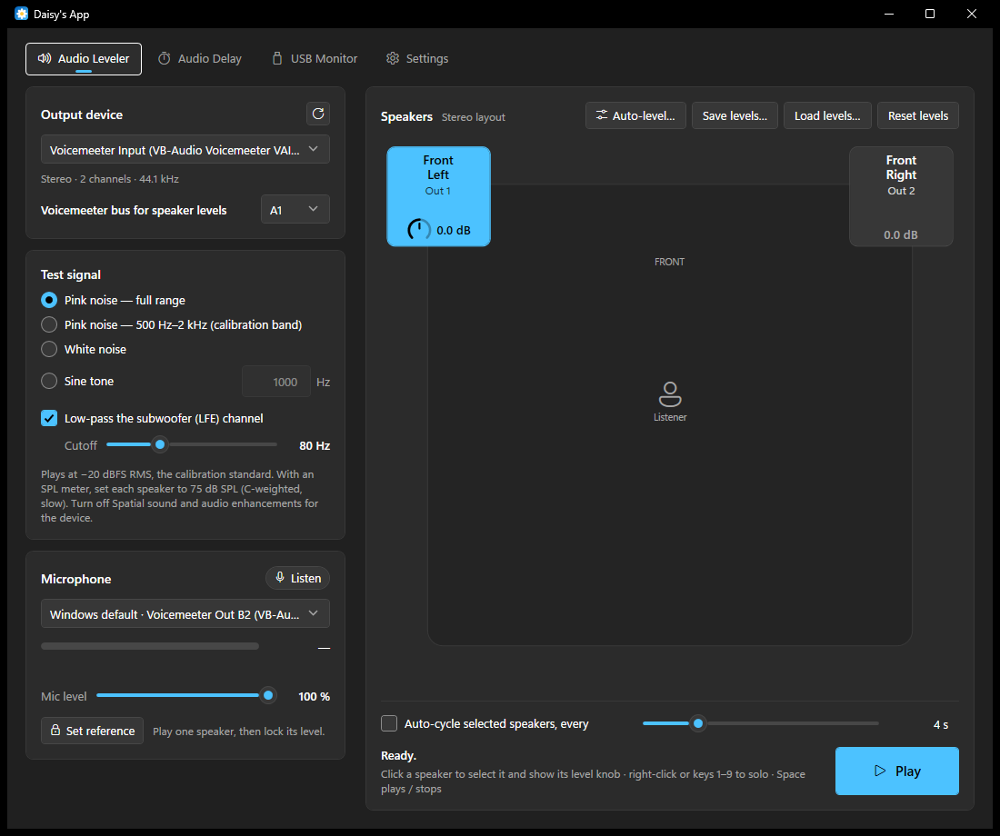

# Daisy's App

**Version 3.0.6** · [Download the latest release](https://github.com/rosscarlson/DaisysApp/releases/latest) · [What's new](CHANGELOG.md)

A multitool app for Windows: one window of small tools, each on its own tab: hardware monitoring, audio levels and
EQ, window and screen tools, recording, network monitoring, file tools, controller mapping and racing, and AI coding
sessions. Each tab is a **module** the app loads from its `modules` folder, with its own guide; switch any of them off
and it isn't loaded at all. Some modules hold several tools, each on its own sub-tab. There are two downloads: **Daisy's App**, with every module, and the small **[wrapper](#the-wrapper)**, which asks which
tools you want and downloads only those.



**This README is about the app itself.** What each module does, and how its code works, is in its own guide (below),
so the two never say the same thing twice.

## The modules

| Tab | Its tools | Guide |
|---|---|---|
| Hardware | Performance · USB Monitor · Devices · Sensors | [src/Modules/Hardware](src/Modules/Hardware/README.md) |
| Audio | Volume · Levels · Delay | [src/Modules/AudioTools](src/Modules/AudioTools/README.md) |
| Video | Resizer ([its own module](src/Modules/Resizer/README.md)) · Mini Mirror · Overlay · Recording | [src/Modules/Video](src/Modules/Video/README.md) |
| Network | Zabbix · Logs | [src/Modules/Network](src/Modules/Network/README.md) |
| Tools | File Sync · Disk Usage · Renamer · Notepad | [src/Modules/Tools](src/Modules/Tools/README.md) |
| Gaming | Button2Key (controller buttons to keys, mouse and macros, a profile per game), Button2Key Remote (ButtScreens: screens of buttons on your phone, tablet or PC, or popped out here, that do what Button2Key's inputs do, in BigButts per game, started from templates for Forza Horizon, iRacing, Star Citizen, Elite Dangerous and ACC; with an [Android app](clients/android/README.md)), ForzaWheel (wheel, pedals, shifter and button boxes as one vJoy wheel for Forza Horizon, and an input overlay that logs your sessions) Forza Analysis (those sessions analysed for smooth braking and throttle) and iRacing (your iRacing history, imported from a browser export or synced from its Data API, in numbers and graphs), each its own module | [src/Modules/Gaming](src/Modules/Gaming/README.md): [Button2Key](src/Modules/Joy2Key/README.md), [Button2Key Remote](src/Modules/Butt2KeyRemote/README.md), [ForzaWheel](src/Modules/ForzaWheel/README.md), [Forza Analysis](src/Modules/ForzaAnalysis/README.md), [iRacing](src/Modules/iRacing/README.md) |
| AI | AI sessions in tabs, side by side: Claude Code (your own sign-in, with several Claude accounts to switch between), or Gemini, OpenAI, OpenRouter, Ollama and other OpenAI-compatible models through its own agent; chat, and let it write and edit code, with live gauges, your Claude plan's usage, carrying on by itself after a limit, and remote control of the sessions on other PCs | [src/Modules/AI](src/Modules/AI/README.md) |
| *(Template)* | A hello-world module, off by default: the guide to writing one | [src/Modules/Template](src/Modules/Template/README.md) |

Each module's guide links to a guide for each of its tools (e.g. [Tools → Disk Usage](src/Modules/Tools/DiskUsage/README.md)),
which ends with a **Code** section: its files and what each one does.

---

## Contents

- [Install](#install)
- [Using the app](#using-the-app)
- [Settings → General](#settings--general)
- [Translations](#translations)
- [Files and command line](#files-and-command-line)
- [Updates](#updates)
- [The wrapper](#the-wrapper)
- [Project layout and modules](#project-layout-and-modules)
- [Build and release](#build-and-release)
- [Third-party](#third-party)
- [Version history](CHANGELOG.md)

---

## Install

1. Download `DaisysApp-Setup-x.y.z.exe` from the [latest release](https://github.com/rosscarlson/DaisysApp/releases/latest).
2. Run it. Windows asks for admin approval, because the app installs to `C:\Program Files\Daisys App`.
   The installer isn't code-signed, so SmartScreen may warn: choose **More info → Run anyway**.
3. Start **Daisy's App** from the Start menu.

Everything the app needs is included (.NET doesn't have to be installed). Installing a newer version upgrades in
place. Uninstall from Settings → Apps → *Daisy's App*; that closes a running copy and removes the sign-in entry and
the update tasks.

---

## Using the app

- **Tabs.** One per module, then **Settings**, always last. Right-click a tab to rename it (Enter saves, Esc cancels);
  drag it to move it, as in a browser (it follows the pointer and the others slide out of its way). A module with
  several tools shows them as sub-tabs at the top of its tab; the one used last opens next time. Modules can share a
  tab too (Gaming: Button2Key, ForzaWheel, Forza Analysis and iRacing; Video: the Resizer joins it): the app builds the tabs from the modules it
  finds, so one that's missing just leaves its sub-tab out.
- **Update** (the download icon, right of the tabs): installs a newer version if there is one (see [Updates](#updates)).
  After it come modules' own buttons (Core's `Shell/QuickButtons`): the **notepad** icon pops out Tools → Notepad, or
  brings its window to the front if it's out already.
- **Opening files with it.** A module can be Windows' app for a file type (Tools → Notepad, for text files): Windows
  then starts the app with `--open file`; a copy started so hands the file to the running one (`Shell/FileHandoff`, a
  named pipe of the user's) and exits, and Core's `Shell/OpenFiles` gives it to the module. Started with a file, the
  main window stays in the tray (when that's on).
- **Title bar bubbles**: a green bubble after the app's name and version while something is running: **ForzaWheel**
  (its emulator), **Button2Key** (a profile in use), **Button2Key Remote** (while it's on) and **Webcam** (Video's virtual webcam; red while it's muted); and the AI's amber or red one when your Claude plan is near or at
  its limit, while a Claude Code session is working. Each tool has a setting to leave its bubble out.
- **Only one copy runs.** Starting it again brings the running copy to the front.
- **The tray.** Closing the window keeps the app running in the tray (if that's on); right-click the tray icon to open
  it, check for updates, use the modules' own tray items, or exit.
- **The notification bar** (at the top of the window): updates and app-wide messages. A message such as *Updated to
  version …* fades away by itself after the time set in Settings → General → **Notifications**; problems, an update
  on offer and things in progress stay until you close them.
- **The setup wizard.** The first time the window opens after installing, a short setup asks which modules to switch
  on (each with a one-line description) and lets you drag them into the order you want their tabs in. Then come steps
  from the modules themselves (each module's guide says what its step is). **Back** goes to the step before, on every
  step. Changes restart the app. After that it opens by itself only when a module is missing a setting it can't do
  without (Zabbix switched on but never set up, say), and then with just that module's step: not after every update.
  **Run the setup wizard…** in Settings → General → Modules goes through every step, whatever is set.
- **Saving.** Every setting is saved as soon as it changes (a **✓ Saved** note appears beside it); there's no Save
  button.
- **Confirming.** A button for something that can't be undone (such as **Delete**) doesn't open a question: the first
  click turns it into a red **Confirm?**, and a second click does it. Left alone, it goes back to what it was after a
  few seconds. Every button that needs confirming works this way (since 2.7.1; older ones are changed as their module
  is worked on).

---

## Settings → General

The first page of the Settings tab. After it comes a page for each module that has settings (described in that
module's guide), with a sub-tab per tool where it has several. Every page uses the whole width of the window.

- **Startup and System Tray** (beside Updates) — keep running in the tray when the window is closed (on by default),
  start when you sign in to Windows, and start hidden in the tray.
- **Updates** — the installed version, check for updates when the app starts, **Check for updates** and
  **Release notes**.
- **Modules** — every module the app contains (by its tab), each with an on/off checkbox and its description, and its
  **sub-modules** under it to switch on or off: its own sub-tabs (Hardware's Sensors, Video's Recording…) and the
  modules that share its tab (Gaming's Button2Key, Video's Resizer). A switched-off module or sub-module isn't loaded at
  all (no tab or sub-tab, no settings page, nothing running in the background); its settings are kept for when it's
  switched back on. Switching off a module's last sub-module switches the module off; one that needs another
  (Recording, the Overlay) can't be on without it. Changes apply after a restart: **Restart now** appears when there's
  one to apply. **Run the setup wizard…** opens the setup wizard. Tabs are renamed by right-clicking them.
- **Appearance** (one row with Notifications and Language) — Dark (default), Light, or System theme. **Draw without the
  graphics card** (WPF software rendering, from the next start) is for when the graphics card leaves the window blank;
  the app notices a blank window by itself (`Shell/BlankWindowCheck.cs`: the whole inside one colour twice, 4 s apart)
  and restarts drawn in software for that run (`--software`), with a notice saying how to fix the card.
- **Notifications** — how long the notification bar shows a message before it fades away: 3 seconds to a minute (8 by
  default), or never.
- **Language** — English, plus any language someone has added (see [Translations](#translations)). Takes effect
  after **Restart now**.
- **Storage** (since 1.9.0) — what the app and its tools keep on disk as they run (`Shell/Storage.cs`), each with its
  number of files, size and oldest date, and **Open** for its folder:
  - performance and sensor history;
  - logs;
  - USB monitor logs;
  - driving sessions;
  - AI conversations;
  - iRacing races;
  - EQ wizard runs;
  - downloaded updates.

  Tick the ones to clean up, then **Delete now…** deletes their files older than 7, 14, 30, 60, 90, 180 or 365 days,
  or **Do this by itself each day** does it daily (a couple of minutes after the start, then every 24 hours). Your
  settings are never touched, nor Claude Code's own sessions.
- **Files** — open the settings and logs folders, and **Logging**: Normal or Debug (much more detail, for tracking
  down a problem); **View** opens Network → Logs.

---

## Translations

Every piece of text in the app is in translation files, one per language, as plain JSON next to the program. Only
English ships (since 0.55: Spanish, French and Portuguese were dropped, so each change needn't be translated), but any
language can be added:
- `lang\` beside `DaisysApp.exe` holds the main window's and the Settings page's text.
- `modules\<applet>\lang\` holds each applet's (e.g. `modules\Hardware\lang\`).

Each file maps the English text to its translation, with `_language` naming the language in Settings:

```json
{
  "_language": "Español",
  "Run now": "Ejecutar ahora",
  "Next at {0:t}": "Próxima a las {0:t}"
}
```

**To add a language,** copy `en.json` in each `lang` folder to the language's code (`de.json`, `it.json`…), set
`_language`, and translate the text on the right. Keep the English on the left exactly as it is, and keep the `{0}`,
`{1}`… placeholders (the app fills in the numbers and names; they can move around in the sentence). Anything left out,
or a file that's missing, stays in English. The new language appears in Settings → General → Language.

For developers: code uses `T("text")`, `F("text {0}", value)` and `P(count, "{0} profile", "{0} profiles")`; XAML uses
`{l:Tr 'text'}`. `python tools/strings.py` rewrites every `en.json` from the source (`--prune` drops texts no longer
used); with other languages' files present it also reports what each is missing (`--missing de` lists it), and
`tools/merge_tr.py` merges a table of translations in.

---

## Files and command line

| Item | Location |
|---|---|
| Program | `C:\Program Files\Daisys App\DaisysApp.exe`, with each module in `modules\<Name>\` beside it |
| Settings | `%APPDATA%\DaisysApp\`: `settings.json` (the app), a `<Name>.json` per tool, and a `<Module>.json` per tabbed module remembering which sub-tab was showing; each module's guide names its files |
| Logs | `%LOCALAPPDATA%\DaisysApp\logs\`: the app's and each module's log, one a day (`DaisysApp-10-10-26.log`, `Video-10-10-26.log`…, kept 7 days); modules' own logs as their guides say. If the window stops responding for 10 seconds, a dump of the app goes here too (`DaisysApp-hang-….dmp`, the newest two kept): open it with `dotnet-dump analyze`, then `clrstack` on thread 0, to see what it was busy with |
| Start at sign-in | `HKCU\Software\Microsoft\Windows\CurrentVersion\Run` → `DaisysApp` |
| Data the tools keep | Performance and sensor history in `logs\performance\`; ForzaWheel's driving sessions in `%LOCALAPPDATA%\DaisysApp\ForzaSessions\`; the AI agent's conversations in `%LOCALAPPDATA%\DaisysApp\AI sessions\`; iRacing's races in `%LOCALAPPDATA%\DaisysApp\iRacing\`; see each module's guide. Settings → General → **Storage** shows how much each takes and cleans them up |
| Update downloads | `%TEMP%\DaisysApp-Update\`; a quick update's in `{app}\updates\` |
| Update tasks | Task Scheduler → *DaisysApp* folder: **Update** and **Start** (see [Updates](#updates)) |

(The [wrapper](#the-wrapper) uses its own name in place of DaisysApp throughout: `Wrapper.exe`, `%APPDATA%\Wrapper\`…)

| Argument | Effect |
|---|---|
| *(none)* | Start, or bring the running copy to the front (only one copy runs) |
| `--tray` | Start hidden in the tray (used by start at sign-in) |
| `--exit` | Ask the running copy to exit cleanly (used by the uninstaller) |
| `--restart` | Wait for the running copy to close, then start (used by **Restart now**) |
| `--software` | Draw without the graphics card this time (used when the window came up blank) |
| `--open <file>` | Open the file in the module that opens files (Tools → Notepad), in the running copy if there is one |
| `--install-update` | The Update task: install the newest release from GitHub, with no window (a quick update) |
| `--module-task <module> <class> …` | Run a module's job in a second copy, e.g. as administrator (Core's `ModuleTasks`) |

---

## Updates

On launch (if enabled) and from **Check for updates** (Settings → General, or the tray menu) the app reads the latest
[GitHub release](https://github.com/rosscarlson/DaisysApp/releases). When it's newer, a banner offers **What's new**
and **Install update**; nothing installs until you click. The installer is downloaded, checked against the SHA-256
GitHub publishes for it, run silently (Windows asks for admin approval), and the app restarts on the new version.

**Quick update: the Update button** (its download icon), right of the tabs (double-clicking the Settings tab did this before 1.1.68). It
checks, and if there's a newer version it downloads it (the banner shows how far), closes the app, installs it with no
windows and no questions, and starts the app again on the new version, without the setup wizard (unless the wizard itself has something new; a tool's own first-run setup still
appears if something it needs is missing). If you're up to date it says so. No admin question: the installer registers
two tasks in Task Scheduler (folder *DaisysApp*) for the user installing it: **Update** runs the app's own updater with
that user's highest rights (it only ever installs the newest release it finds on GitHub itself, checked against its
SHA-256, so starting it can't make it run anything else) and **Start** starts the app again with ordinary rights.
Installs from before 0.44 don't have the tasks yet, so the first quick update asks for admin approval once; after
that it doesn't. Uninstalling removes the tasks.

---

## The wrapper

Each release has two downloads:

- **Daisy's App** (`DaisysApp-Setup-x.y.z.exe`, about 46 MB): every module, and the .NET runtime inside, so nothing
  else is needed.
- **The wrapper** (`Wrapper-Setup-x.y.z.exe`, about 2.5 MB): the same program with no modules. It runs on Microsoft's
  .NET 8 Desktop Runtime, which its installer downloads and installs if it isn't there yet (once; other programs use
  it too). Most of Daisy's App's size is that runtime, which is why the wrapper is so much smaller.

The first time the wrapper starts, it shows **Choose your tools**: every module of its version's release, with what it
is and its size. Tick the ones you want and **Install and restart**: only those are downloaded (each checked against
its SHA-256), and the window is built from them, as Daisy's App builds its own: one tool is one tab and Settings, no
sub-tabs; tools that share a tab (Button2Key, ForzaWheel, Forza Analysis and iRacing: Gaming) share it as sub-tabs. **Settings →
General → Add or remove tools…** opens it again: tick more to add them, untick some to remove them.

The tools go in `%LOCALAPPDATA%\Wrapper\modules\` (one folder each, as in Daisy's App's `modules\`). Changes are put in
place when it starts again, before anything loads, since a tool in use can't be replaced. Each tool remembers the
version it came with: when the wrapper updates itself (the Update button, as Daisy's App), it fetches its tools from
the new version's release at the next start and restarts, so the program and its tools always match. Otherwise it
works like Daisy's App: tray, start at sign-in, Settings → General, quick updates; with its own settings
(`%APPDATA%\Wrapper\`), logs (`%LOCALAPPDATA%\Wrapper\logs\`), install folder (`C:\Program Files\Wrapper`), update tasks
(Task Scheduler → *Wrapper*) and single-instance lock, and it runs alongside Daisy's App.

**Which module goes where** is `src/Modules/modules.json`: each module with `DaisysApp` (in Daisy's App's installer)
and `Wrapper` (offered by the wrapper). A module folder that isn't listed goes in both (the build says so). There's
no copy of any code: `build.ps1` builds every module once, puts Daisy's App's in its installer, zips each one offered
to the wrapper (`Module-<name>-x.y.z.zip`), and has the app write the list (`Modules-x.y.z.json`: each module's name,
description, icon and tab from its DLL, and its zip's size and SHA-256); the release carries them all. The wrapper's
name is `$WrapperName` at the top of `build.ps1` (its installer's AppId, `$WrapperGuid`, stays the same if it's
renamed).

To try a build before it's released, set `DAISYSAPP_MODULES_FROM` to the `artifacts` folder: the wrapper then lists
and installs the tools from there.

(Joy2Key (now Button2Key) and Resizer had installers of their own in 1.1.68–1.3.0. Those copies don't update any more: install the
wrapper and pick the tool instead.)

---

## Project layout and modules

Each applet is a **module**: its own project in `src/Modules/<Name>/`, built into its own folder,
`modules\<Name>\`, next to `DaisysApp.exe`. The app loads every module it finds there (unless it's switched off in
Settings → General → Modules), so a module can be added, updated or removed without touching the rest. Each module's
DLL describes itself (`[Applet]`: id, name, icon, place, description, and the tab it shares, if any; a shared tab's
`[assembly: TabGroup]`), and the app builds its tabs from that.

```
src/
  Directory.Build.props   settings every project shares (version, .NET 8, WPF)
  DaisysApp/              the app (Daisy's App, and the wrapper): startup, single instance, window and tabs,
                          the Update button and banner, tray, the title bar's bubbles (Shell/TitleBadgeStrip),
                          Settings → General (with Storage: Shell/Storage), the module loader (Shell/AppletCatalog,
                          which builds the tabs), and the wrapper's modules (Updates/ModuleStore, Shell/ModulePicker);
                          lang/ is its translations
  DaisysApp.Core/         what the app and the modules share, kept small (every app carries it): IApplet + [Applet],
                          [TabGroup], AppletGroup (one tab of sub-tabs; Shell/ToolSwitches: which sub-tabs are switched on), AppPaths (the app's name, from the program's),
                          translations (Loc, {l:Tr}), settings storage (JsonStore), the logs (Logging: Log, ErrorLog,
                          Windows' event logs, HangWatch), theming, title bar bubbles and notifications from modules
                          (Shell/TitleBadges, Shell/Notifications), other modules' channels on the AI module's remote control connection
                          (Shell/RemoteChannels: Tools → Notepad), files opened with the app (Shell/OpenFiles), and Shared/Hotkeys, Shared/Charts (the time
                          graph), Shared/Csv, Shared/LiveDataGrid
  DaisysApp.Shared/       shared code that needs more (only the modules using it bring it, in their folders):
                          Audio (devices, speaker layouts, mic volume; NAudio), Voicemeeter, Hardware (NVIDIA's GPU
                          library, Windows' counters, HDR monitors' SDR brightness, the LibreHardwareMonitor connection)
  Modules/
    Directory.Build.props   makes each folder here a module (output to modules\<Name>\, references Core)
    modules.json            which modules go in Daisy's App and which the wrapper offers
    Template/               a hello-world module, and the guide to writing one
    Hardware/ (Performance/ UsbMonitor/ Sensors/)   AudioTools/ (Levels/ = Volume, Tests/ = Levels, Delay/)
    Video/ (MiniMirror/ Gaming/)   Resizer/   Network/ (Zabbix/ Logs/)   Tools/ (FileSync/ DiskUsage/ Renamer/ Notepad/)
    Joy2Key/   Butt2KeyRemote/   ForzaWheel/   ForzaAnalysis/   iRacing/   Gaming/ (only the Gaming tab's guide: those five share it)   AI/
                            each with its README, lang/ translations and code; a module with several tools
                            (one tab, a sub-tab each) has a folder per tool and an AppletGroup (in Core)
clients/
  android/                Button2Key Remote's Android app (Kotlin, Gradle; its own README), an APK on each release
installed:
  DaisysApp.exe, lang\, modules\<Name>\ (DaisysApp.<Name>.dll, lang\, README.md, its own dependencies)
  the wrapper: Wrapper.exe (the same program, framework-dependent), lang\; the tools it downloads in
  %LOCALAPPDATA%\Wrapper\modules\<Name>\
```

**Documentation.** This README covers the app (the shell, Settings → General, translations, files, updates, the
build); each module's `README.md` covers that module, and each tool's (in its folder) what it does and, in its
**Code** section, its files. A change to a module only touches that module's guides; a release adds its line to
[CHANGELOG.md](CHANGELOG.md).

**To write a module,** copy `src/Modules/Template`, rename it, and follow
[src/Modules/Template/README.md](src/Modules/Template/README.md). The Template ships with the app but is off: tick it
in Settings → General → Modules to see it. The UI follows the design system in `design.md` (styles in
`src/DaisysApp/Themes/Controls.xaml`, available to every module). A button that needs confirming is a two-click
**Confirm?** button, never a question window (see [Using the app](#using-the-app); Button2Key Remote's
`RemoteView.ConfirmButton` is one: `DangerButton` style on the first click, back after 4 seconds).

## Build and release

Requires the .NET 8 SDK and Inno Setup 6 (`winget install JRSoftware.InnoSetup`).

```powershell
dotnet build DaisysApp.sln   # the app and every module (modules land in src\DaisysApp\bin\...\modules)
.\build.ps1                  # -> artifacts\DaisysApp-Setup-<version>.exe, Wrapper-Setup-…, Module-<name>-….zip, Modules-….json
```

To release: bump `<Version>` in `src/Directory.Build.props` (and the version at the top of this file), add the
release to [CHANGELOG.md](CHANGELOG.md), commit,
then tag and push, e.g. `git tag v0.6.3; git push origin v0.6.3`. The Release workflow builds the installers on GitHub
and publishes the release (with every app's installer) that installed copies update from. CI builds every push to `main`.

## Third-party

[NAudio](https://github.com/naudio/NAudio) (MIT), [softcam](https://github.com/tshino/softcam) (MIT, the virtual webcam; built with `tools/build-softcam.ps1` into `third_party/softcam`), [LibreHardwareMonitor](https://github.com/LibreHardwareMonitor/LibreHardwareMonitor) (read over its web server if you run it; not included), [Vortice.Windows](https://github.com/amerkoleci/Vortice.Windows) (MIT, Mini Mirror's screen capture and Gaming's recording), [Material Design Icons](https://pictogrammers.com/library/mdi/) (Pictogrammers, icons Apache 2.0: Button2Key Remote's icon library), .NET 8 runtime (bundled), Inno Setup (installer). The Resizer is ported
from [Resize Rabbit](https://github.com/rosscarlson/resize-rabbit) and [Resize Raccoon](https://github.com/mistenkt/resize-raccoon)
by mistenkt (MIT). Voicemeeter and
its Remote API are VB-Audio's (installed separately, not shipped).
